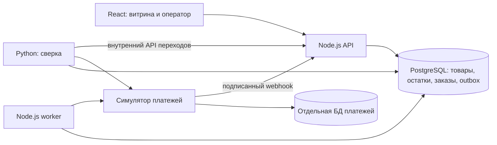
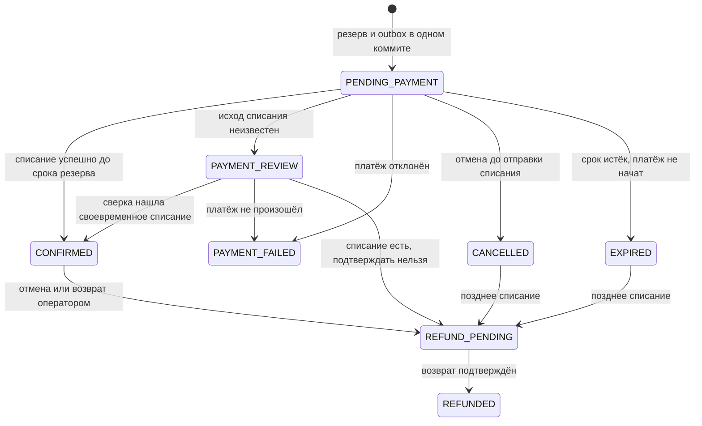

# Технический план: платформа заказов для распродажи

## Цель и границы

Демо продаёт ограниченный остаток при одновременных запросах. Ключевое свойство: один физический экземпляр товара не может попасть в два подтверждённых заказа. Витрина и панель оператора написаны на React; каталог, корзина, заказ и фоновый обработчик — на Node.js/TypeScript; Python сверяет заказы, остатки и платёжный журнал. Платёжный сервис — локальный симулятор со своей базой и возможностью воспроизвести частичные сбои. Авторизация через заголовки служит только локальной демонстрации.

PostgreSQL выбран как источник истины для остатков: условный `UPDATE` и строковая блокировка обеспечивают атомарный резерв без распределённого замка. Корзина и каталог размещены там же, потому что объём демо не оправдывает отдельное хранилище. Платёжный журнал отделён, чтобы воспроизводить потерю ответа после сохранённого списания. Очередь сейчас — `outbox` в PostgreSQL с `FOR UPDATE SKIP LOCKED`: этого достаточно для одного типа команд и нескольких worker-процессов. Цена решения — опрос базы и дополнительная нагрузка на неё. Брокер и полноценный `inbox` нужны на этапе нескольких независимых потребителей; таблица `inbox` уже определена, но текущий обработчик её не использует.

## Инварианты и решения

| Решение | Сохраняемый инвариант | Компромисс |
| --- | --- | --- |
| `inventory.total = available + reserved + sold`, все три счётчика неотрицательны; резерв через `UPDATE ... WHERE available >= quantity` | Нельзя зарезервировать больше имеющегося остатка даже при гонке запросов | Горячий SKU сериализует обновления одной строки; при большом пике возможна очередь на блокировку |
| Все SKU заказа обновляются в одной транзакции, в порядке SKU | Частично зарезервированный многотоварный заказ не фиксируется; порядок уменьшает риск взаимной блокировки | Транзакция держит блокировки до конца обработки заказа |
| Ключ `(user_id, Idempotency-Key)` уникален; хеш нормализованного состава заказа и HTTP-ответ хранятся вместе | Повтор того же запроса возвращает тот же `201` или `409`; повтор ключа с другим составом отклоняется | Сохранённый `409` остаётся `409` после пополнения: новая попытка требует нового ключа; записи требуют срока хранения и очистки в будущей версии |
| При нехватке товара `SAVEPOINT` откатывает строки заказа и движения остатка, а основная транзакция фиксирует ответ `409` | Проигравшая попытка не оставляет резерва и сохраняет идемпотентный результат | Есть дополнительная операция savepoint; нестандартные ошибки откатывают всю транзакцию |
| Резерв живёт пять минут по времени PostgreSQL | После истечения нельзя начать новое списание по этому резерву; неуверенный платёж удерживает остаток до выяснения | Неизвестный результат может надолго задержать продажу; нужны сверка и мониторинг `PAYMENT_REVIEW` |
| `payment_operations.provider_key` уникален; симулятор сохраняет результат под тем же ключом | Повтор вызова списания или возврата не создаёт вторую денежную операцию | Требуется провайдер с поддержкой идемпотентности или собственная процедура поиска операции |
| Заказ, резерв и команда `outbox` фиксируются одним коммитом; worker арендует команду и повторяет её после сбоя | Команда платежа не теряется после сохранения заказа; повтор безопасен за счёт ключа провайдера и условных переходов | Доставка как минимум один раз, а не «ровно один раз»; возможны задержки и повторные вызовы |
| Webhook имеет HMAC-подпись и уникальный `(provider, event_id)`; переходы блокируют строку заказа | Повтор webhook не применяет подтверждение повторно | Дубли с новым `event_id` всё ещё возможны, поэтому переходы и платёжная операция также идемпотентны |
| При timeout после возможного списания заказ становится `PAYMENT_REVIEW`; Python сверяет журнал и вызывает API перехода | Неизвестный платёж не трактуется как неудачный и не освобождает товар преждевременно | Сверка асинхронна; если провайдер недоступен, оператор видит затянувшийся случай |
| После истечения срока и задержки симулятор атомарно закрывает отсутствующий ключ списания как `FAILED` | Гонка между поздним `INSERT` списания и освобождением резерва завершается одним итогом в уникальном ключе журнала | Требует от платёжного провайдера операции окончательного закрытия/отмены; обычный `404` без такого контракта недостаточен |
| Отмена подтверждённого заказа создаёт возврат; позднее успешное списание после освобождения резерва также создаёт возврат | Деньги не остаются списанными за заказ, который не может быть подтверждён; товар не продаётся дважды | Возврат асинхронен и может потребовать ручного разбора; возврат денег сам по себе не возвращает товар в продажу |

Ограничение `CHECK` защищает арифметику одного SKU. Сверка Python дополнительно сравнивает `reserved` с суммой `HELD`-резервов, а `sold` — с суммой `CONSUMED`-резервов. Проверка этих двух сумм обнаруживает расхождение, которое не видно по `CHECK` одной строки.

## Таблицы и ключи

Полная исполняемая схема: [`db/schema.sql`](../db/schema.sql), схема симулятора: [`db/simulator.sql`](../db/simulator.sql).

| Таблица | Основные поля и ограничения |
| --- | --- |
| `products` | `sku` PK, цена в целых центах, валюта, активность |
| `inventory` | `sku` PK/FK, `total`, `available`, `reserved`, `sold`, `CHECK` равенства и неотрицательности |
| `carts`, `cart_items` | Корзина по `user_id`, позиции `(user_id, sku)`, версия корзины |
| `orders`, `order_items` | UUID заказа, пользователь, состояние, снимок цены/названия и суммы на момент покупки |
| `reservations`, `reservation_items` | Один резерв на заказ, `HELD/CONSUMED/RELEASED`, срок `expires_at`, количества по SKU |
| `idempotency_keys` | PK `(user_id, key)`, `request_hash`, код и тело исходного ответа, ссылка на заказ при `201` |
| `payment_operations` | Уникальный `provider_key`, тип `CAPTURE/REFUND`, сумма, статус и время операции |
| `outbox` | UUID события, тип, заказ, статус `READY/LEASED/DONE`, срок аренды, число попыток |
| `provider_events` | PK `(provider, event_id)` для повторов webhook |
| `inbox` | PK `(consumer, event_id)` для будущего потребителя брокера; пока не используется |
| `inventory_movements`, `reconciliation_cases` | Аудит изменений и открытые/закрытые случаи расхождения |
| `payment_ledger` в другой БД | Уникальный ключ провайдера, заказ, тип, сумма, результат, время |

## Состояния заказа

`PAYMENT_REVIEW` удерживает `HELD`-резерв, пока исход операции не определён. Если успешный платёж был выполнен до `expires_at` и резерв ещё удержан, поздний ответ может подтвердить заказ. Если резерв уже освобождён или клиент запросил отмену, успешный ответ запускает возврат. Ошибка возврата оставляет `REFUND_PENDING` и открывает случай для оператора.

## Последовательности операций

1. **Создание.** API нормализует позиции, проверяет ключ, открывает транзакцию, сохраняет запись идемпотентности, обновляет остатки условным `UPDATE`, создаёт заказ/резерв/операцию `CAPTURE`/outbox и фиксирует `201`. При нехватке товара savepoint откатывает изменения заказа, но сохраняет `409` под ключом.
2. **Списание и подтверждение.** Worker арендует команду, переводит операцию в `IN_FLIGHT`, вызывает симулятор с `capture:{order_id}`. Подписанный webhook или ответ worker фиксирует результат. В транзакции под блокировкой заказа `reserved` переходит в `sold`, резерв — в `CONSUMED`, заказ — в `CONFIRMED`. Повторный ответ не меняет счётчики.
3. **Отмена и истечение.** Пока `CAPTURE` ещё в `QUEUED`, резерв можно освободить сразу. Для `IN_FLIGHT/UNKNOWN` отмена отмечает намерение и ждёт выяснения. Просроченный резерв освобождается, только если платёж не начат; иначе заказ переходит в `PAYMENT_REVIEW`.
4. **Сбой после списания.** Симулятор сохраняет `SUCCEEDED`, затем теряется HTTP-ответ и webhook. Worker видит неизвестный результат, оставляет резерв и повторяет вызов под тем же ключом. Python запрашивает платёжный журнал и применяет результат через `/internal/settle`. Если после истечения срока журнал возвращает `404`, Python просит симулятор атомарно закрыть ключ: закрытие и начатое списание соревнуются за один уникальный ключ. Так не возникает ни второго списания, ни продажи освобождённого экземпляра. Если подтверждение уже невозможно, создаётся `REFUND`.
5. **Возврат.** После подтверждённой отмены или позднего списания транзакция создаёт `REFUND` и outbox. Worker отправляет `refund:{order_id}`; повтор безопасен. Симулятор блокирует исходное списание при создании возврата и проверяет сумму всех успешных возвратов: она не может превысить сумму списания даже при разных ключах и одновременных запросах. Успех переводит заказ в `REFUNDED`; неуспех остаётся видимым оператору.

## HTTP API

| Метод и путь | Результат |
| --- | --- |
| `GET /products`, `GET /products/:sku` | Каталог и отображаемый остаток |
| `GET /cart`, `PUT /cart/items/:sku` | Корзина демо-пользователя |
| `POST /orders` | `201` с заказом либо сохранённый `409 OUT_OF_STOCK`; заголовки `x-user-id`, `Idempotency-Key` |
| `GET /orders/:id` | Состояние, позиции, резерв и платёжные операции владельца |
| `POST /orders/:id/cancel` | Идемпотентная отмена или начало возврата по ключу запроса |
| `POST /payment-webhooks/simulator` | Подписанное событие симулятора |
| `POST /internal/settle` | Применение результата сверки через общую машину состояний; отдельный `x-reconciler-token` |
| `GET /operator/inventory`, `POST /operator/inventory/:sku/adjust` | Проверка и изменение доступного остатка |
| `GET /operator/reconciliation`, `POST /operator/orders/:id/refund` | Разбор исключений и возврат |
| `POST /operator/orders/:id/refund/retry` | Новая попытка неуспешного возврата с новым ключом провайдера |

Внешние клиенты должны использовать настоящую аутентификацию и права доступа; `x-user-id` и локальный токен оператора здесь демонстрационные.

## Этапы реализации

1. **Рабочее ядро — выполнено.** Схема PostgreSQL, каталог, корзина, `POST /orders`, атомарный резерв, TTL, снимок цен, React-витрина и панель оператора.
2. **Сбои и деньги — выполнено.** Отдельный платёжный журнал, уникальные ключи операций, outbox worker, webhook, отмена/возврат, неопределённый исход и Python-сверка. Проверка 5 000 попыток и локальная демонстрация потерянного ответа.
3. **Распределённый вариант — план.** Несколько экземпляров API и worker при общей транзакционной БД; метрики ожидания блокировки горячих SKU; нагрузочное испытание на отдельной машине. Если появляются независимые подписчики, перенести доставку из outbox в брокер и применить `inbox` у каждого подписчика. Сохранить PostgreSQL источником истины для остатков и ключей; брокер не решает гонку резерва.
4. **Эксплуатация — план.** Настоящие роли, секреты, миграции без простоя, политика хранения ключей и событий, алерты по `PAYMENT_REVIEW`, неуспешным возвратам, возрасту outbox и расхождению остатков, восстановление из резервной копии.

## Воспроизводимая нагрузка и доказательства

Сценарий [`load/sale.js`](../load/sale.js): 1 000 SKU, из них 3 горячих; 20 000 возможных идентичностей; 2 000 запросов/с на 3 минуты; 70% запросов каталога, 20% оформления, 10% корзины; 80% оформлений на горячие SKU; 10% повторов ключа; пополнение каждого горячего SKU на 100 единиц на 60-й и 120-й секундах. Пороги: `catalog p95 < 150 мс`, `checkout p95 < 500 мс`, доля HTTP 5xx `< 0,5%`, `dropped_iterations = 0`. Отдельно считать ожидаемые `409` и `429`, задержку блокировки БД, возраст outbox, `PAYMENT_REVIEW`, ошибки возврата и расхождение счётчиков.

Локальные 20-секундный и трёхминутный прогоны и окружение записаны в [`load/REPORT.md`](../load/REPORT.md), сырые выводы — в [`load/peak-summary.json`](../load/peak-summary.json) и [`load/full-summary.json`](../load/full-summary.json). Они не означают 20 000 одновременных соединений и не доказывают производительность в продакшене. Тест `apps/api/test/concurrency.test.ts` подтверждает на тестовой БД ровно 100 победителей из 5 000 ожидающих вызовов при запасе 100 единиц, повторное применение платежа без второго списания товара и другие заявленные переходы. Пул ограничен 20 соединениями, поэтому это не 5 000 одновременно выполняющихся SQL-транзакций.

Для резюме: «Разработал портфолио-платформу flash sale на Node.js/TypeScript, React, Python и PostgreSQL; реализовал атомарное резервирование, идемпотентные платежи, outbox и сверку частичных сбоев. В локальном тесте 5 000 конкурентных запросов на 100 единиц получены ровно 100 резервов; трёхминутный k6-прогон достиг около 2 000 запросов/с без HTTP 5xx». Не заявлять реальный продакшен-трафик или работу с настоящим платёжным провайдером.
